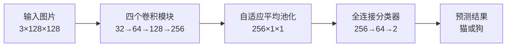

# 基于 PyTorch CNN 的猫狗图像分类项目说明

## 项目概述

本项目面向猫狗图像二分类任务，使用 PyTorch 从零构建并训练卷积神经网络（Convolutional Neural Network，CNN）。模型接收一张猫或狗的 RGB 图片，经过多层卷积特征提取和全连接分类后，输出 `cat` 与 `dog` 两个类别的预测结果。

项目实现了从数据读取、图像预处理、模型训练、验证评估到结果可视化的完整流程。模型未使用预训练权重，最终在 500 张验证图片上取得 **76.60%** 的总体准确率，并且猫、狗两个类别的识别效果基本均衡。

## 1 任务说明

本项目需要解决一个监督学习中的二分类问题：根据输入图片的视觉特征，判断图片主体属于猫还是狗。

项目的主要目标包括：

- 使用 PyTorch 独立实现一个适用于图像分类的 CNN；
- 完成训练集与验证集的自动读取和标签识别；
- 使用数据增强、正则化和学习率调整提高模型的泛化能力；
- 记录训练损失、验证损失和准确率变化；
- 使用分类准确率与混淆矩阵分析模型表现；
- 保存验证效果最好的模型，而不是简单使用最后一轮权重。

## 2 数据集

实验数据集共包含 2500 张图片，训练集与验证集均保持猫狗类别平衡。

| 数据划分 | 猫图片 | 狗图片 | 合计 |
| --- | ---: | ---: | ---: |
| 训练集 | 1000 | 1000 | 2000 |
| 验证集 | 250 | 250 | 500 |

程序可以从类别子文件夹或图片文件名中识别标签，内部类别映射为：

- `cat`：类别编号 0；
- `dog`：类别编号 1。

`CatDogDataset` 会递归查找 JPG、JPEG、PNG、BMP 和 WebP 图片，并检查数据中是否同时包含猫、狗两个类别。无法识别标签或无法读取的图片会触发明确的错误提示，以避免错误数据进入训练过程。

## 3 图像预处理

所有图片首先转换为 RGB 格式，并统一缩放为 `128 × 128`。训练集与验证集使用不同的预处理策略。

训练阶段的数据处理包括：

- 将图片缩放至 `128 × 128`；
- 以 0.5 的概率进行水平翻转；
- 在正负 10 度范围内随机旋转；
- 对亮度和对比度进行轻微随机扰动；
- 将图片转换为张量；
- 使用均值 0.5、标准差 0.5 进行归一化，使像素值近似分布在 `[-1, 1]`。

验证阶段不使用随机数据增强，只执行尺寸调整、张量转换和归一化，以保证不同轮次的评价条件一致。

## 4 CNN 模型设计

项目采用一个从零训练的轻量级 CNN。特征提取部分由四个卷积模块组成，每个模块依次执行 `3×3 卷积 → 批归一化 → ReLU → 2×2 最大池化`。卷积保持特征图的空间尺寸，最大池化将宽和高分别缩小一半。



各阶段的输出尺寸如下：

| 阶段 | 主要操作 | 输出尺寸 |
| --- | --- | --- |
| 输入 | RGB 图片 | `3 × 128 × 128` |
| 卷积模块 1 | Conv 3→32、BN、ReLU、MaxPool | `32 × 64 × 64` |
| 卷积模块 2 | Conv 32→64、BN、ReLU、MaxPool | `64 × 32 × 32` |
| 卷积模块 3 | Conv 64→128、BN、ReLU、MaxPool | `128 × 16 × 16` |
| 卷积模块 4 | Conv 128→256、BN、ReLU、MaxPool | `256 × 8 × 8` |
| 池化 | Adaptive Average Pooling | `256 × 1 × 1` |
| 分类器 | Flatten、Dropout、Linear、ReLU、Dropout、Linear | `2` |

分类器的具体结构为：

1. 将 `256 × 1 × 1` 的特征展平为 256 维向量；
2. 使用概率为 0.4 的 Dropout；
3. 使用全连接层将特征从 256 维映射到 64 维；
4. 使用 ReLU 激活函数；
5. 使用概率为 0.2 的 Dropout；
6. 使用全连接层输出两个类别的得分。

模型共有 **405,474 个可训练参数**。卷积层采用 Kaiming 初始化，批归一化层的缩放参数初始化为 1，线性层使用均值为 0、标准差为 0.01 的正态分布初始化。

## 5 训练策略

本次实验的主要配置如下：

| 配置项 | 取值 |
| --- | --- |
| 最大训练轮数 | 20 |
| 批大小 | 32 |
| 输入尺寸 | `128 × 128` |
| 优化器 | Adam |
| 初始学习率 | 0.001 |
| 权重衰减 | 0.0001 |
| 损失函数 | CrossEntropyLoss |
| Dropout | 0.4 和 0.2 |
| 随机种子 | 42 |
| 早停耐心值 | 5 轮 |

训练过程使用交叉熵损失衡量预测结果与真实标签之间的差异，并通过 Adam 优化器更新模型参数。`ReduceLROnPlateau` 调度器持续观察验证损失；当验证损失停止改善时，学习率会降低为原来的一半。

在支持 CUDA 的设备上，程序自动启用混合精度训练，以减少显存占用并提高训练速度。每轮训练结束后，程序都会在验证集上进行完整评估。当验证准确率提高，或准确率相同但验证损失更低时，当前模型会被保存为新的最佳检查点。

## 6 评价方法

项目使用以下指标评价模型：

- **训练损失与验证损失**：反映模型预测结果与真实标签之间的差异；
- **训练准确率与验证准确率**：反映整体分类正确的比例；
- **分类别准确率**：分别计算猫和狗的识别准确率；
- **混淆矩阵**：统计两个类别被正确识别和相互误判的数量；
- **最佳轮次**：记录验证集表现最好的训练轮次。

模型最终评价使用最佳检查点完成，因此训练后期的指标波动不会直接降低最终结果。

## 7 实验结果

本次训练完成 20 轮，最佳模型出现在第 17 轮，训练总耗时约 103.2 秒。

| 指标 | 结果 |
| --- | ---: |
| 最佳轮次 | 17 |
| 最佳轮次训练损失 | 0.5090 |
| 最佳轮次训练准确率 | 74.80% |
| 验证损失 | 0.4837 |
| 验证集总体准确率 | **76.60%** |
| 猫类别准确率 | 76.80% |
| 狗类别准确率 | 76.40% |

验证集的混淆矩阵如下：

| 真实类别 \\ 预测类别 | 猫 | 狗 |
| --- | ---: | ---: |
| 猫 | 192 | 58 |
| 狗 | 59 | 191 |

在 250 张猫图片中，有 192 张被正确识别；在 250 张狗图片中，有 191 张被正确识别。两个类别的准确率只相差 0.40 个百分点，说明模型没有明显偏向某一个类别。

最佳轮次的验证准确率略高于训练准确率，主要是因为训练阶段启用了随机数据增强和 Dropout，而验证阶段关闭了这些随机扰动。训练样本在训练时更难，因此该差异属于合理现象，并不表示数据泄漏。

## 8 程序流程

项目的核心执行流程为：

1. 查找训练集和验证集目录；
2. 扫描图片并根据目录名或文件名确定标签；
3. 创建训练集和验证集的数据变换；
4. 使用 DataLoader 分批读取图片；
5. 创建 `CatDogCNN` 并将模型放置到 CPU 或 GPU；
6. 按轮执行前向传播、损失计算、反向传播和参数更新；
7. 在验证集上计算损失与准确率；
8. 保存验证表现最好的模型；
9. 使用最佳模型计算分类别准确率与混淆矩阵；
10. 导出训练记录、图表和结果摘要。

## 9 项目结构

```text
cat_dog_pytorch_assignment/
├─ train.py                 训练模型、验证模型并导出实验结果
├─ predict.py               使用最佳模型预测单张图片
├─ check_environment.py     检查程序可使用的计算设备
├─ generate_report.py       根据真实训练结果生成实验报告
├─ package_submission.py    整理代码提交文件
├─ requirements.txt         项目依赖清单
├─ README.md                项目说明文档
└─ catdog/
   ├─ __init__.py
   ├─ data.py               数据扫描、标签识别和图像预处理
   ├─ model.py              CNN 网络结构与参数初始化
   ├─ engine.py             单轮训练和验证逻辑
   └─ utils.py              随机种子、指标计算、绘图和结果保存
```

## 10 模块职责

### `train.py`

项目的训练入口，负责组织数据集、DataLoader、模型、损失函数、优化器、学习率调度器和训练循环，并在训练结束后生成完整评价结果。

### `catdog/data.py`

负责发现图片、识别标签和构建数据变换。该模块同时兼容按类别划分的目录结构和文件名带有 `cat`、`dog` 标记的平铺结构。

### `catdog/model.py`

定义 `ConvBlock` 和 `CatDogCNN`。模型结构与数据读取、训练逻辑相互独立，便于单独修改卷积层数量、通道数或分类器结构。

### `catdog/engine.py`

封装训练与验证共用的单轮执行逻辑。训练模式会计算梯度并更新参数，验证模式则关闭梯度计算，只统计损失、准确率、标签和预测结果。

### `catdog/utils.py`

负责设置随机种子、计算混淆矩阵与分类别准确率，以及保存训练历史、曲线图和 JSON 结果。

### `predict.py`

读取最佳模型检查点，对单张图片执行与验证阶段一致的预处理，并输出预测类别和对应置信度。

## 11 输出文件

模型训练完成后，`artifacts/` 目录用于保存实验产物：

| 文件 | 内容 |
| --- | --- |
| `best_model.pth` | 验证表现最好的模型参数及必要配置 |
| `history.csv` | 每轮训练与验证的损失、准确率和学习率 |
| `training_curves.png` | 损失曲线与准确率曲线 |
| `confusion_matrix.png` | 验证集混淆矩阵 |
| `results.json` | 数据集、参数、运行信息与最终指标摘要 |

这些文件用于复现实验分析和生成报告，不属于项目源代码本身。

## 12 项目特点与局限

项目具有以下特点：

- CNN 完全从零训练，网络结构和训练过程清晰可解释；
- 数据读取兼容两种常见的猫狗数据组织方式；
- 训练与验证逻辑分离，代码结构清晰；
- 自动保存最佳模型，避免使用训练后期退化的权重；
- 自动生成训练曲线、混淆矩阵和结构化结果文件；
- 猫狗两类数据和评价结果均较为平衡。

当前模型也存在一定局限：训练数据规模较小，网络未使用预训练特征，对复杂背景、遮挡、极端姿态或主体较小的图片仍可能发生误判。后续可以通过扩大数据集、分析误分类样本、调整数据增强方式或引入迁移学习进一步提升准确率。

## 13 结论

本项目完成了一个结构完整的 PyTorch 猫狗图像分类系统。实验使用四个卷积模块提取图像特征，通过自适应平均池化和全连接分类器输出猫狗预测结果，并结合数据增强、Dropout、权重衰减、学习率调整和最佳模型保存机制提高训练稳定性。

最终模型在 500 张验证图片上取得 76.60% 的总体准确率，猫、狗类别准确率分别为 76.80% 和 76.40%。结果表明，该模型已经能够学习猫狗图片中的有效视觉特征，并完成课程作业要求的图像二分类任务。
